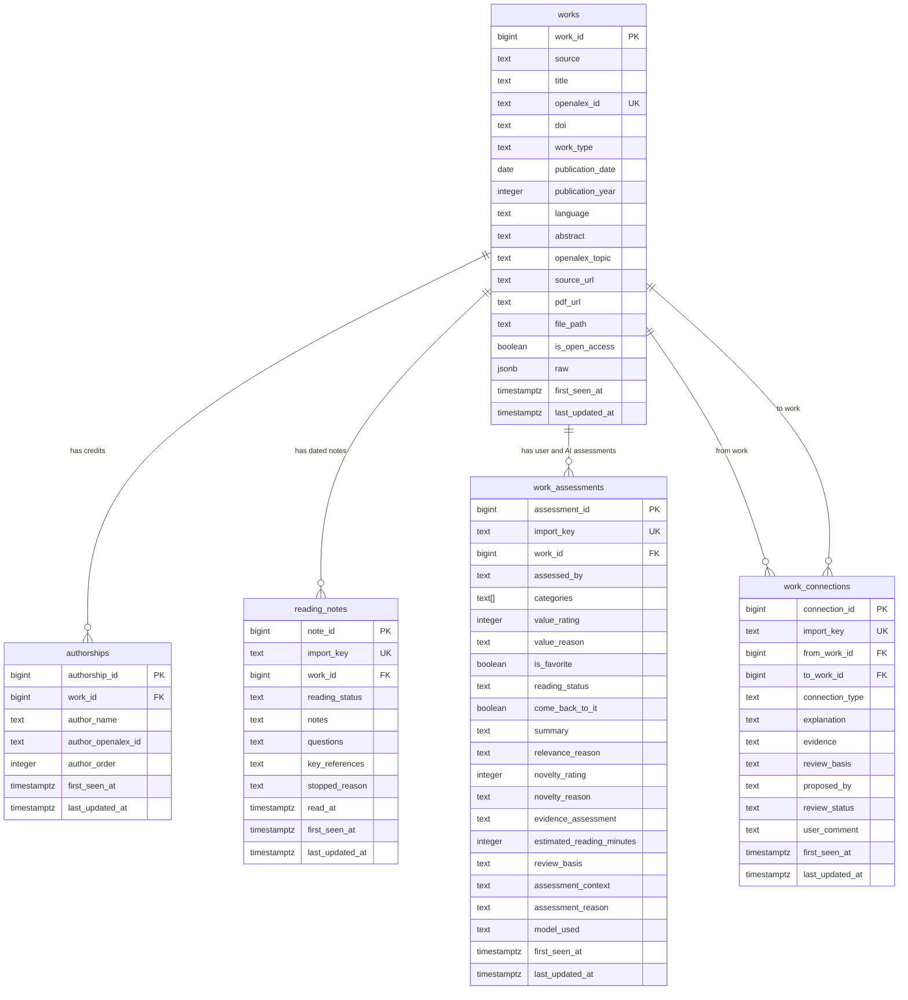

# Reading library schema

Updated November 7, 2026. This five-table design supersedes the seven-table draft.
The SQL is setup for a NEW database, not a migration of an existing database.
Live setup and loading passed November 7, 2026; see `load_verification.md`.
Exhaustive invalid-input and application permission tests remain separate work.

## Entity-relationship diagram and data types



## What each row represents

- **works:** One OpenAlex item or upload, with source metadata, local identity, and audit dates.
  No personal ratings, favorite flag, current reading status, or AI assessments live here.
- **authorships:** One person or organization credited on one work. Names, optional
  source IDs, and optional positive list order support citations without author profiles.
- **reading_notes:** One dated, editable personal note. A work can have many notes;
  reading_status is the snapshot at the time of the note, not current progress.
  An optional unique import key preserves the original chat/message identity when
  recovering notes without duplication. The current user reading status is stored
  separately in the user's assessment row. Unknown actual reading dates stay null;
  original message dates and exact wording are retained in a private import archive.
- **work_assessments:** One user or AI assessment of one work, distinguished by assessed_by.
  Each work has at most one editable user assessment, enforced by a partial unique
  index, while AI reassessments create additional rows to preserve history.
- **work_connections:** One explained, directed relationship between two different
  works, including proposer and suggested/accepted/rejected status. AI suggestions
  are immediately usable; the student does not need to accept or reject them.

## Assessments and UI behavior

Both user and AI assessments use value_rating (integer 1–5 or NULL). For the user it
means experienced value; for AI it means predicted value. Interest and usefulness
are combined. There is no separate relevance score; relevance_reason explains the
connection to the user's interests. Novelty remains a distinct 1–5 rating.

The user's row holds is_favorite (clickable UI star), current reading_status, and
come_back_to_it. AI rows must leave those personal controls NULL. A user can toggle
the star or rate an item without writing a note: create/update the user assessment.
An absent favorite is displayed as off; missing reading progress means unrecorded,
not proof of unread status. Revisit NULL means undecided. No ratings are fabricated.
User rows do not require model_used, review_basis, or assessment_reason. AI rows
require all three; model_used must be NULL on user rows.

For each work, fetch the user row separately from the latest AI row. Select latest
AI using first_seen_at DESC, assessment_id DESC with assessed_by = 'ai'. Editing an
older assessment does not make it newest. Routine source imports never assess items
or overwrite user opinions. Preserve assessment author/work identity when editing.

An optional unique `import_key` identifies each saved assessment batch/item. Reimporting
the approved batch skips those same records; a deliberate future reassessment uses a
new batch ID. This does not restrict the number of historical AI assessments per work.

## Categories

There are no categories or work_categories tables. work_assessments.categories is a
PostgreSQL text array restricted to Learning, Work, Information, Society, Technology,
and Discovery. The UI should offer multiple selections and prevent duplicate choices.
The database rejects invalid names and NULL elements in the list.

| Category | Guiding question |
|---|---|
| Learning | How does AI affect learning, thinking, and creativity? |
| Work | How does AI change jobs, businesses, and productivity? |
| Information | How does AI affect what we see, believe, and trust? |
| Society | How does AI affect rights, fairness, and relationships? |
| Technology | How does AI work, and what makes it succeed or fail? |
| Discovery | How does AI advance science, health, and the environment? |

Use the user's categories when non-NULL; otherwise use the latest AI categories.
NULL means no personal override. An empty array means an explicit choice of no
categories and must NOT fall back to AI. New AI assessments never replace user choices.
Category assignment history is not a separate feature.

## Design rationale and constraints

**Decision debated: category tables versus a category list.** We considered separate
category and work/category linking tables, but chose a controlled text array on each
assessment because the six categories are a small, fixed vocabulary without additional
category records to manage. This allows multiple categories and keeps the user's
choices separate from AI suggestions with fewer tables; the trade-off is that category
descriptions live in documentation, changing the allowed list requires a schema change,
and duplicate choices must be prevented by the application.

Source facts, user opinions, and AI predictions remain distinguishable without separate
user/AI assessment tables. The user rejected category lookup/linking tables in favor
of a controlled list on assessments, and rejected separate interest/usefulness ratings.
Repeated author names across works are an accepted trade-off: author profiles are not
central to the reading decision. OpenAlex author IDs are unique per work when present.
The authorship work/order pair is also unique when known; names are not identity keys.

Uploads require a title, source, and nonblank file reference. OpenAlex records require
a unique source ID. Other metadata can remain NULL, and works need not have author
credits, notes, or assessments. Publication dates use date; audit and reading instants
use timestamptz. JSONB keeps original metadata; arrays keep multiple categories.
Notes and key references are text, while modeled connections use foreign keys.
Connections cannot link a work to itself. Estimates must be positive when supplied.

Connections have an optional unique `import_key` for duplicate-free AI imports.
The importer derives it from the source pair, relationship type, proposer, and
abstract review basis. For `overlaps` and `related_topic`, endpoint order does not
change identity; those relationships are stored once. Direction is preserved for
supports, challenges, and extends. Reimports preserve explanations, user comments,
status, and audit timestamps. This key identifies a relationship, not a new
historical assessment. Existing databases use the additive migration
`db/migrations/001_connection_import_key.sql`; new databases use `db/schema.sql`.

All five tables retain first_seen_at and last_updated_at, displayed as Created and
Last edited. Triggers preserve creation time and stamp edits. Editable user assessments
and notes do not preserve every previous edit; only AI reassessments have separate rows.

## Loading, privacy, and implementation stages

The parameterized loader imports works before author credits, using ON CONFLICT DO
NOTHING. An optional approved assessment JSON batch is loaded after works, with abstract
hash checks and unique import keys. The optional `--connections` batch loads saved
AI suggestions after validating both source abstracts. The loader itself does not
generate assessments, notes, or connections.
Search groups remain in the original local selection manifest; they are neither
columns on works nor automatic library categories. Author order comes from the source
array. The original authorship details remain in raw JSON.

All five tables enable row-level security with no API policies or public grants.
Owners can still access them; this alone is not application authentication. Future
limited roles and sign-in must protect personal data and uploaded files. A public
catalog should expose only explicitly approved source fields, excluding private file
paths. Leave the Supabase Data API and automatic exposure options disabled.

The initial chat-generated assessments and connection suggestions are now imported.
The UI, user-editing workflows, automated generation, and uploads remain future work.
The current loader handles the reviewed OpenAlex snapshot and saved private batches.

Offline validation: 504 works, 1,516 usable author credits, 16 missing abstracts,
2 missing dates, and 21 works without usable credits. Incomplete credits are warned
about, skipped, and retained in raw. These are transformation counts, not database
row counts. Live setup and duplicate-free loading are now documented in
`load_verification.md`. Seven business queries now run successfully; results and
interpretation are in `questions.md`. Future application-role permissions and
the student's final submission review remain separate work.


## Access roles

Part B addition (November 11, 2026): `sync_state` stores transactional pipeline
progress as JSON keyed by pipeline name. Migration 005 adds it; `db/roles.sql`
grants app_reader SELECT and a matching read policy. A repeated access check
passed for all six tables. New-table evidence:

```text
SELECT count(*) FROM public."sync_state";
  SELECT succeeded; rows: 0
DELETE FROM public."sync_state" WHERE false;
  permission denied (SQLSTATE 42501) [expected]
INSERT INTO public."sync_state" ("pipeline") SELECT "pipeline" FROM public."sync_state" WHERE false;
  permission denied (SQLSTATE 42501) [expected]
[ok] All 6 tables readable; INSERT and DELETE denied; no changes committed.
```

The original five-table evidence below is retained as the Part A verification.

Setup status (November 11, 2026): `db/roles.sql` applied to the live database.
`app_reader` has LOGIN, no elevated role flags, SELECT on all five data tables,
and a SELECT-only row-level security policy on each table. It has no direct
INSERT, UPDATE, DELETE, or TRUNCATE table grants. Personal data remains private:
these policies apply only to the application role, not anonymous API callers.
The application must still authenticate its users before exposing private notes.

The password must be set separately in the Supabase SQL editor, never in a
committed file. Store its Session pooler URL only in ignored local `.env` as
`APP_DATABASE_URL`; `.env.example` already includes the empty variable.
Use the same host, port, database, and project reference as `DATABASE_URL`,
with username `app_reader.<project-ref>` and the new role password.

### Login and permission evidence

Verified November 11, 2026, using the configured Session pooler reader login:

```powershell
.\.venv\Scripts\python.exe scripts/check_db.py --app
.\.venv\Scripts\python.exe scripts/check_access.py
```

Actual output (both commands exited successfully):

```text
[ok] Connected using APP_DATABASE_URL
     Database user: app_reader
     Server: PostgreSQL 17.11 on x86_64-pc-linux-gnu
Database user: app_reader
SELECT count(*) FROM public."works";
  SELECT succeeded; rows: 570
DELETE FROM public."works" WHERE false;
  permission denied (SQLSTATE 42501) [expected]
INSERT INTO public."works" ("title") SELECT "title" FROM public."works" WHERE false;
  permission denied (SQLSTATE 42501) [expected]
SELECT count(*) FROM public."authorships";
  SELECT succeeded; rows: 1520
DELETE FROM public."authorships" WHERE false;
  permission denied (SQLSTATE 42501) [expected]
INSERT INTO public."authorships" ("work_id") SELECT "work_id" FROM public."authorships" WHERE false;
  permission denied (SQLSTATE 42501) [expected]
SELECT count(*) FROM public."reading_notes";
  SELECT succeeded; rows: 18
DELETE FROM public."reading_notes" WHERE false;
  permission denied (SQLSTATE 42501) [expected]
INSERT INTO public."reading_notes" ("work_id") SELECT "work_id" FROM public."reading_notes" WHERE false;
  permission denied (SQLSTATE 42501) [expected]
SELECT count(*) FROM public."work_assessments";
  SELECT succeeded; rows: 563
DELETE FROM public."work_assessments" WHERE false;
  permission denied (SQLSTATE 42501) [expected]
INSERT INTO public."work_assessments" ("work_id") SELECT "work_id" FROM public."work_assessments" WHERE false;
  permission denied (SQLSTATE 42501) [expected]
SELECT count(*) FROM public."work_connections";
  SELECT succeeded; rows: 140
DELETE FROM public."work_connections" WHERE false;
  permission denied (SQLSTATE 42501) [expected]
INSERT INTO public."work_connections" ("from_work_id") SELECT "from_work_id" FROM public."work_connections" WHERE false;
  permission denied (SQLSTATE 42501) [expected]
[ok] All five tables readable; INSERT and DELETE denied; no changes committed.
```

Write probes use `WHERE false`
and rollback, so even incorrectly granted permissions cannot change data.
The script also checks for unexpected non-SELECT table grants and schema CREATE.

Supabase's postgres login could not SET ROLE app_reader, so actual verification
used the separate app_reader login rather than impersonation. The initial
attempt to alter restricted role flags also failed and rolled back; the corrected
script relies on PostgreSQL's safe new-role defaults and checks existing flags.

### Data API and future tables

Data API disabled status: verified November 11, 2026, from the user's dashboard
screenshot and confirmation. Integrations > Data API > Overview showed Enable
Data API off and the notice "No schemas can be queried." The user confirmed no
setting had been changed and Save was inactive, indicating the disabled state
was already saved. No dashboard change was necessary.
For every new data table (starting with `sync_runs`), add an explicit SELECT grant
and, if RLS is enabled, a SELECT policy to `db/roles.sql`, rerun it as postgres,
and include the table in `scripts/check_access.py`. Future tables receive no
automatic app_reader grant.

## Part C: sync_runs (November 12, 2026)

Migration 006 adds the per-run history table with a UUID primary key, start/finish
timestamps, status CHECK (success/partial/failed), nonnegative fetched/inserted/
updated counts, safe error_message, and trigger CHECK (manual/schedule). Extra
fields distinguish dry runs, discovery vs targeted maintenance, and outcomes.
`db/roles.sql` includes the SELECT grant and policy; both were applied. Owner
writes only; app_reader SELECT works and INSERT/DELETE both returned permission
denied (42501). All seven tables passed `scripts/check_access.py`.
See [actual run evidence and semantics](sync_runs.md) and `db/sync_status.sql`.
